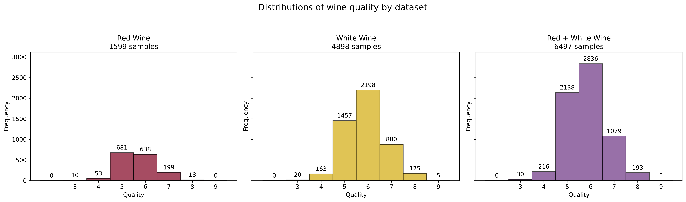
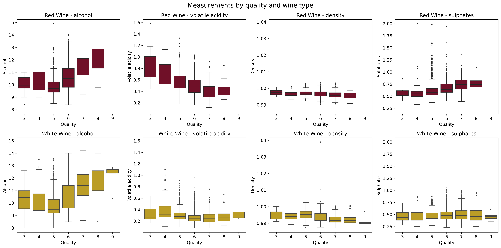
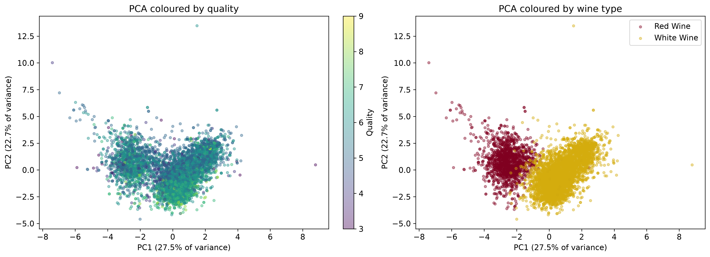

# Alexandre — report draft and remaining work

> Notes de préparation, à retirer du rapport final. Le texte du rapport commence à « Algorithm demonstration ». Les observations ci-dessous proviennent de `SVM_project.ipynb`. Aucun SVM n'a encore été entraîné : le protocole proposé et les résultats à compléter sont signalés explicitement.

## Périmètre de ma contribution

| Alexandre | Natalia | Orla |
| --- | --- | --- |
| Données, protocole expérimental, exécution du SVM, interprétation des résultats, conclusions | Introduction, fonctionnement et conception de l'algorithme | Comparaisons avec d'autres algorithmes, usages dans la recherche |

L'effet pratique de `C` et `gamma` peut être étudié dans ma démonstration, en renvoyant à la théorie de Natalia. Une référence majoritaire sert seulement à vérifier l'intérêt des prédictions ; les comparaisons détaillées avec d'autres modèles restent dans la partie d'Orla.

## À mettre en place pour terminer ma partie

1. **Préparer les données de modélisation.** Créer des copies sans doublons, sans modifier les données utilisées pour l'exploration. Vérifier les effectifs par note après cette opération. Conserver les 11 mesures ; ajouter seulement `is_white` pour le modèle combiné, sans `type` ni `quality` parmi les entrées.
2. **Fixer un protocole reproductible.** Pour chaque jeu de données, réserver 20 % des observations comme test avec `random_state=42` et une séparation stratifiée par note. Vérifier qu'aucune observation identique ne se retrouve dans les deux ensembles. Garder ces mêmes ensembles pour les expériences suivantes.
3. **Entraîner un premier SVM.** Utiliser une `Pipeline` avec `StandardScaler` puis `SVC(kernel="rbf")`. La standardisation doit être apprise uniquement sur les données d'entraînement. Ne pas réutiliser le scaler ou la PCA de l'exploration.
4. **Mesurer l'effet des paramètres.** Proposition de grille courte : `C = [0.1, 1, 10]` et `gamma = [0.01, 0.1, 1]`. Utiliser une validation croisée stratifiée à trois plis sur l'entraînement, après vérification des effectifs des classes les plus rares. Sélectionner les paramètres selon le F1 macro et montrer un tableau ou une petite heatmap des scores de validation. Le test ne sert pas à choisir les paramètres.
5. **Présenter plusieurs exemples.** Appliquer le même protocole aux vins rouges, blancs et au jeu combiné. Cela fournit plusieurs démonstrations de l'algorithme sans commencer la comparaison avec d'autres familles de modèles.
6. **Évaluer les modèles retenus.** Comparer leur accuracy à celle d'un `DummyClassifier(strategy="most_frequent")`, appris sur l'entraînement. Ajouter le F1 macro, les effectifs et résultats par classe, ainsi que les matrices de confusion. Comme les notes sont ordonnées, on peut aussi compter la proportion de prédictions à un point près, en complément de l'exactitude stricte.
7. **Finaliser le texte.** Remplacer les passages « To complete » par les résultats mesurés. Rédiger les conclusions sur cette base, puis intégrer quelques phrases de synthèse des parties de Natalia et d'Orla lorsqu'elles seront disponibles.

Cette liste est un plan de travail : elle ne décrit pas des expériences déjà réalisées. Il n'est pas nécessaire d'ajouter une implémentation NumPy, du suréchantillonnage ou une longue recherche de paramètres pour obtenir une démonstration claire.

---

## Algorithm demonstration

### Dataset and prediction task

We use the Wine Quality dataset described by Cortez et al. [1]. It contains physicochemical measurements and quality scores for red and white Portuguese Vinho Verde wines. Our task is to predict the quality score, rather than the wine colour. We treat each observed score as a class while keeping in mind that the scores are ordered.

The original data contain 1,599 red wines and 4,898 white wines, giving 6,497 observations in total. Each observation has 11 measured input variables, including alcohol, volatile acidity, density and sulphates. The combined dataset also contains wine-type indicators: `type` and `is_white` encode the same information.

### Initial exploration

No missing values were found. However, the red dataset contains 240 duplicate rows and the white dataset contains 937, counting repeated rows after their first occurrence. These observations are retained for the descriptive analysis. Before modelling, repeated observations need to be handled so that identical rows cannot appear in both training and test data.

| Property | Red wine | White wine | Combined |
| --- | ---: | ---: | ---: |
| Original observations | 1,599 | 4,898 | 6,497 |
| Missing values | 0 | 0 | 0 |
| Duplicate rows after the first occurrence | 240 | 937 | 1,177 |
| Most frequent quality score | 5 | 6 | 6 |
| Share of the most frequent score | 42.6% | 44.9% | 43.7% |

The quality scores are unbalanced. As shown in Figure A1, scores 5 and 6 account for 76.6% of the combined data, whereas only five observations have a score of 9. Always predicting 6 would match 43.7% of the original combined observations. This percentage is a descriptive reference, not an evaluated model result. During evaluation, the majority-class prediction must be determined from the training set only.

*Figure A1: Number of observations at each quality score in the original red, white and combined datasets. The labels above the bars show the counts.*

Alcohol has the strongest positive Pearson correlation with quality among the measured variables: 0.476 for red wines and 0.436 for white wines. In the combined data, density and volatile acidity have negative correlations with quality of -0.306 and -0.266, respectively. These associations do not establish cause and effect.

Figure A2 shows that alcohol generally increases with quality, but the distributions overlap between scores. Relationships also differ between wine types: sulphates correlate with quality at 0.251 for red wines but only 0.054 for white wines. This supports examining the wine types separately as well as together.

*Figure A2: Boxplots of alcohol, volatile acidity, density and sulphates by quality score. Red wines appear in the top row and white wines in the bottom row. The box shows the middle 50% of observations and its central line shows the median.*

The variables have different numerical scales. For example, density is close to 0.995 in the combined data, while total sulfur dioxide ranges from 6 to 440. We therefore plan to standardise the inputs for the SVM. Some distributions also have long tails, but extreme observations have not been removed simply because they are far from the median.

For a visual overview, we applied PCA to the 11 standardised measurements, excluding quality and wine-type indicators from the inputs. The first two components explain 50.2% of their total variation. Figure A3 shows a more visible separation by wine type than by quality score. However, this projection leaves out almost half of the variation and cannot establish how well an SVM will classify the wines. Its preprocessing was fitted on all observations for exploration only.

*Figure A3: The same two-component PCA projection coloured by quality on the left and wine type on the right. PC1 explains 27.5% of the variation in the standardised measurements and PC2 explains 22.7%.*

### Experimental protocol — proposed, not yet executed

We will evaluate an RBF SVM on the red, white and combined datasets using the same procedure. Exact duplicate rows will be removed before splitting. For each dataset, 20% of the remaining observations will be reserved as a stratified test set with a fixed random seed. The combined model will use the 11 measurements and `is_white`; the separate models will use the 11 measurements only.

Standardisation and classification will be combined in a pipeline. The scaler will be fitted separately within each training fold. A small grid of `C` and `gamma` values will be evaluated using three-fold stratified cross-validation on the training set, subject to checking the rare-class counts. The selected model will then be evaluated on the reserved test set.

We will report accuracy, macro-averaged F1 and the confusion matrix. Macro-averaged F1 gives each quality class equal weight, making it useful alongside accuracy for these unbalanced data. A majority-class baseline fitted on the training set will provide a simple reference. Results for rare scores will be interpreted cautiously because their test support will be very small.

### SVM results — to complete

*No model scores are available yet. Fill this table from the executed notebook; percentages in the exploration must not be reused as test scores.*

| Dataset | Training / test samples | Selected C / gamma | Validation F1 macro | Baseline test accuracy | SVM test accuracy | SVM test F1 macro |
| --- | --- | --- | --- | --- | --- | --- |
| Red wine | To complete | To complete | To complete | To complete | To complete | To complete |
| White wine | To complete | To complete | To complete | To complete | To complete | To complete |
| Combined | To complete | To complete | To complete | To complete | To complete | To complete |

*After running the experiments, describe the effect of the parameters, the improvement over the baseline, and which quality scores are most often confused. Distinguish validation scores used for parameter selection from final test scores. Add numbered captions and references in the text for the parameter plot and confusion matrices.*

## Conclusions — preliminary draft

The initial exploration shows that wine quality is associated with several physicochemical measurements, particularly alcohol, but that individual measurements do not clearly separate the scores. Red and white wines also differ in composition, so both separate and combined demonstrations are useful.

The main issues identified before modelling are repeated rows, different feature scales and a strong imbalance between quality scores. These observations motivate a careful split, standardisation learned from training data, and evaluation beyond overall accuracy.

*To complete after evaluation: state whether the SVM improves on the baseline, summarise the main observed effect of its parameters, and explain its most important prediction errors. Do not claim that the SVM works well before measuring its test performance. Integrate the group's findings about algorithm design, alternative methods and research applications once those sections are available.*

## Reference for this contribution

[1] P. Cortez, A. Cerdeira, F. Almeida, T. Matos and J. Reis (2009). *Modeling wine preferences by data mining from physicochemical properties*. Decision Support Systems, 47(4), 547–553. DOI: 10.1016/j.dss.2009.05.016. Dataset metadata are included in `data/winequality.names`.

> Integration notes: renumber sections, Figures A1–A3 and reference [1] when merging into the group report. The code remains in `SVM_project.ipynb` and can be placed in the report appendix. The proposed protocol must be updated to match the experiments actually performed.
